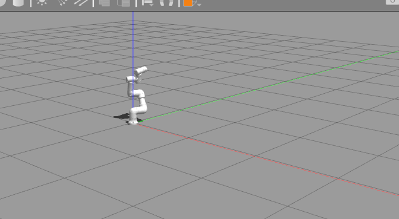

# s3_60_eco_2024

埃斯顿酷卓 S3-60 Eco 2024 机器人模型的 ROS 2（Humble）描述包，由 ROS 1 catkin 包
`S3-60 Eco 2024` 移植而来。

## 运行

### RViz 里看模型

```bash
cd <本工作区>
source /opt/ros/humble/setup.bash
colcon build --packages-select s3_60_eco_2024
source install/setup.bash
ros2 launch s3_60_eco_2024 display.launch.py
```

可选参数：`gui:=false` 关闭关节滑条，`rviz:=false` 关闭 RViz2（此时可用
`ros2 run joint_state_publisher_gui joint_state_publisher_gui` 之外的方式提供
`/joint_states`，例如从真机或 `ros2 topic pub` 发布）。

### Gazebo 里跑仿真（Gazebo Classic + ros2_control）

```bash
source /opt/ros/humble/setup.bash
source install/setup.bash
ros2 launch s3_60_eco_2024 gazebo.launch.py            # 启动 Gazebo、加载控制器
ros2 run s3_60_eco_2024 demo_trajectory.py             # 另开终端：让机械臂走一段轨迹
ros2 run s3_60_eco_2024 demo_trajectory.py --home      # 回到零位
ros2 run s3_60_eco_2024 demo_trajectory.py 0 -0.5 0.7 0 0.5 0   # 指定六个关节角（弧度）
```

`demo_trajectory.py` 会读 `/joint_states`，向 `joint_trajectory_controller` 发一条
JointTrajectory 目标，最后打印跟踪误差；跟踪不上时以非零退出码结束，方便判断
"控制器在跑但机械臂没动"这类问题。



launch 参数：

| 参数 | 默认值 | 说明 |
| --- | --- | --- |
| `gui` | `true` | 是否打开 Gazebo 客户端；无显示环境用 `gui:=false` |
| `rviz` | `false` | 是否同时打开 RViz2 |
| `use_sim_time` | `true` | 用 Gazebo 的 `/clock` 作为时间源 |
| `gravity` | `false` | 见下面"关于重力" |
| `z` | `0.016` | 基座生成高度（米），见下面"关于生成高度" |

## 相对原始包做过的修改

1. 包名 `S3-60 Eco 2024` → `s3_60_eco_2024`：ROS 2 包名不允许大写和空格，
   原先的 `package://S3-60 Eco 2024/...` 网格路径在 ROS 2 中无法解析。
2. URDF 中机器人名同步改为 `s3_60_eco_2024`，网格路径改为
   `package://s3_60_eco_2024/meshes/...`。
3. 关节限位由 SolidWorks 导出的全零占位值
   （`lower=0 upper=0 effort=0 velocity=0`，滑条无法拖动）改为控制器配置中的实际值：
   - 位置限位来自 `v1.6.6.19T/.../control/config/parameter/robot/base.yaml`
     的 `jointPositionLimit`：J1/J2/J4/J5/J6 ±200°，J3 ±163°；
   - 速度限位来自 `S3-60-PRO.yaml` 的 `jointMaxVelocity`：J1-J3 150°/s，J4-J6 180°/s；
   - 力矩限位来自 `base.yaml` 的 `outLimitTrqTrack`：80/100/80/50/50/50 N·m。

   这些是控制器软件中的安全限位，不一定等于机械极限范围；如需精确值请以官方
   数据手册为准。
4. launch 文件改写为 ROS 2 Python launch（`robot_state_publisher` +
   `joint_state_publisher_gui` + `rviz2`），并新增 RViz 配置文件
   `rviz/display.rviz`（原包中 `display.launch` 引用的 `urdf.rviz` 实际不存在）。
5. 新增 Gazebo Classic + `ros2_control` 支持：
   - `urdf/s3_60_eco_2024.gazebo.urdf.xacro`：在原始 URDF 基础上加 `world`
     固定关节（把机械臂焊死在地上，不让它倒）、`ros2_control` 系统以及
     `gazebo_ros2_control` 插件；六个关节暴露位置指令 + 位置/速度状态接口。
   - `config/controllers.yaml`：`joint_state_broadcaster` 与
     `joint_trajectory_controller`（位置指令、闭环校验）。
   - `launch/gazebo.launch.py`：起 Gazebo、生成模型、等模型进世界后再
     spawn 两个控制器。
6. 针对 SolidWorks 导出的模型在 Gazebo 里的三个坑做了处理，都在
   `launch/gazebo.launch.py` / xacro 里有注释：
   - **惯量**：导出值里有 0 和负数的主惯量，ODE 求解器无法处理（表现是机械臂
     完全不理指令）。launch 里把主惯量下限抬到 `1e-3 × 质量`，其余元素不变。
   - **`package://` 路径**：Gazebo Classic 在这里不会解析 `package://`，网格打
     不开时整个模型（含插件）都不会加载，所以启动时统一改写成 `file://`。
   - **XML 注释**：`gazebo_ros2_control` 会把 `robot_description` 当作参数覆盖
     规则传给 controller manager，rcl 按 YAML 解析，注释里的 `: ` 会让解析失败，
     因此传给 `robot_state_publisher` 之前把注释剥掉。

## 关于重力

默认 `gravity:=false`（见 `urdf/s3_60_eco_2024.gazebo.urdf.xacro` 的 `gravity`
参数，只作用于 `link1`~`link6`）：机械臂像真机伺服抱闸一样，走完一条轨迹后停在
原处。若打开重力，`joint_trajectory_controller` 在轨迹结束、目标为静止时不再
持续输出保持力矩，机械臂会缓慢下垂，需要自己加重力补偿或额外的保持控制器：

```bash
ros2 launch s3_60_eco_2024 gazebo.launch.py gravity:=true
```

## 关于生成高度

生成的基座网格比 `base_link` 原点低 15 mm，直接放在 `z=0` 会插进地面，接触求解
器会把整条机械臂甩到一个随机姿态并持续抖动（关节速度能到几十 rad/s，但位置看着
"没动"）。所以默认生成高度是 `z=0.016`，留 1 mm 间隙；如果改用别的世界/地面
高度，用 `z:=<高度>` 覆盖即可。

## 已验证

在 Humble + Gazebo 11 上实测：

- 启动后不发指令，六个关节 40 s 内稳定在 0（位置、速度都是 0.000）；
- `demo_trajectory.py` 走到 `[0.4, -0.5, 0.7, 0, 0.5, 0]`，跟踪误差 0.00°；
- 轨迹结束后 15 s 仍停在目标位。

## 未包含 / 待做

- 力矩接口与动力学仿真：现在只暴露位置指令接口，做轨迹跟踪够用；要做力控/
  碰撞接触仿真，需要加 `effort` 接口并配 PID、重力补偿。
- MoveIt 配置（SRDF、运动规划）与真机桥接（`codroid_bridge`）尚未接进来。
